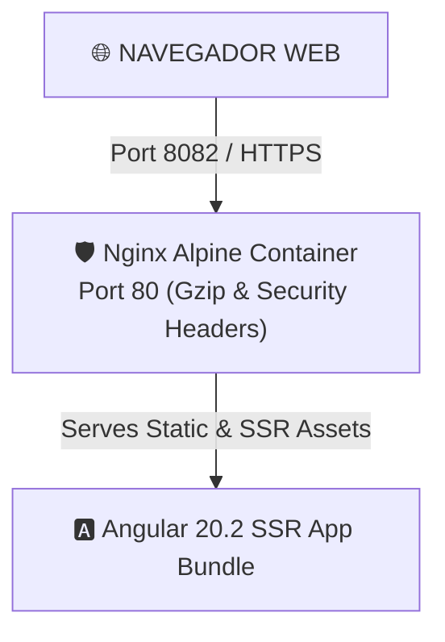

# 🏛️ proto-landing-ui — Architecture & C4 Model Specification

> **Producto:** proto-landing-ui  
> **Versión:** 1.0.0 Enterprise  
> **Área / Lab:** Architecture (`AIASDD`) & Engineering (`AISL`)  

---

## 1. 🌐 Arquitectura de Despliegue Multi-Stage Nginx

---

## 2. 🧩 Componentes de la Aplicación Angular 20.2

- **HeroComponent**: Banner principal con CTA.
- **TechStackComponent**: Matriz de tecnologías base del ecosistema.
- **ShowcaseComponent**: Tarjetas dinámicas del portafolio.
- **ContactFormComponent**: Formulario reactivo de captura de leads.
