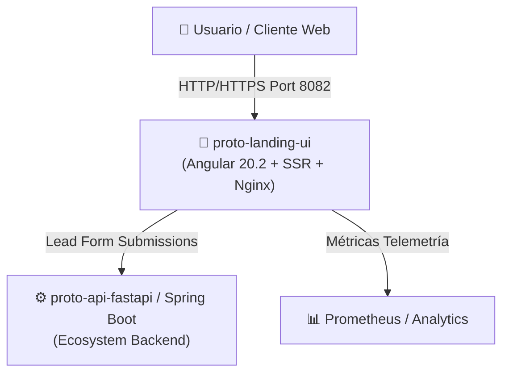
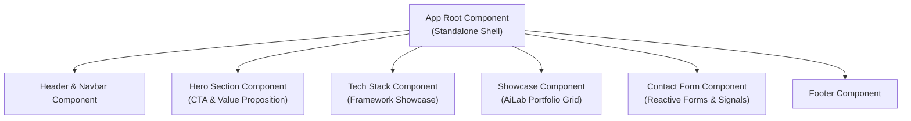

# 🏛️ proto-landing-ui — Architecture & C4 Model Specification

> **Producto:** proto-landing-ui  
> **Versión:** 1.0.0 Enterprise MVP  
> **Gobernanza:** FDP Standard v1.5.0 (`AISL`)  
> **Stack:** Angular 20.2.0 + Tailwind CSS 4.0 + SSR + Nginx Alpine Container  

---

## 1. 🎯 Resumen Ejecutivo & Visión Arquitectónica

`proto-landing-ui` es la plataforma web pública y vitrina digital del ecosistema **AiLab**. Está diseñada como una aplicación web de alto rendimiento combinando **Angular 20 Standalone Components**, **Signals** para reactividad ultra-eficiente y **Server-Side Rendering (SSR)** servido tras una capa de proxy inverso Nginx altamente optimizado.

---

## 2. 🧱 C4 Model Specification

### Nivel 1: Diagrama de Contexto de Sistema (Context)



### Nivel 2: Diagrama de Contenedores (Container)

```mermaid
graph TD
    subgraph Docker Container ["🐳 Docker Container (proto-landing-ui-prod)"]
        Nginx["🛡️ Nginx Alpine (Reverse Proxy & Static Web Server)"]
        BrowserBundle["⚡ Angular Client Bundle (Browser Distribution)"]
        ServerBundle["🟢 Node / Express SSR Server Bundle (Optional SSR Worker)"]
    end
    
    UserBrowser["🌐 Navegador del Cliente"] -->|Fetch HTML/JS/CSS| Nginx
    Nginx -->|Sirve Assets Estáticos Comprimidos (Gzip/Brotli)| BrowserBundle
    Nginx -.->|Renderizado Dinámico SSR| ServerBundle
```

### Nivel 3: Diagrama de Componentes (Component Structure)



---

## 3. ⚡ Atributos de Calidad y Rendimiento (NFRs)

| Dimensión | Requisito / Estrategia | Métrica Objetivo |
| :--- | :--- | :--- |
| **Performance** | Asset Optimization (Gzip + WebP), Angular Signals, Zoneless Change Detection | LCP < 1.2s, INP < 100ms, FCP < 0.8s |
| **Seguridad** | Nginx Security Headers (X-Frame-Options, CSP, HSTS, X-Content-Type-Options) | Grade A+ Security Scan |
| **Disponibilidad** | Multi-stage Docker build con Nginx unprivileged Alpine container | 99.9% Uptime SLA |
| **SEO** | Meta tags dinámicos mediante Angular Server-Side Rendering (SSR) | 100/100 Lighthouse SEO |

---

## 4. 🔒 Estrategia de Despliegue Containerizado Multi-Stage

```dockerfile
# Multi-stage build concept:
# Stage 1: Build (Node 22 Alpine + npm run build)
# Stage 2: Serve (Nginx 1.27 Alpine + static asset copy + custom nginx.conf)
```

1. **Compilación estricta:** `ng build --configuration production` genera código minificado tree-shaken.
2. **Distribución Nginx:** Servido en puerto 80 dentro del contenedor y mapeado externamente al puerto `8082`.

---

## 5. 📑 Trazabilidad & FDP

- **Master PRD:** [PRD.md](file:///Users/ad9sebastian.zapata/Documents/LABORATORIOS/IA/AISL/ia-projects-output/proto-landing-ui/docs/PRD.md)
- **Estrategia de Producto:** [PRODUCT_STRATEGY.md](file:///Users/ad9sebastian.zapata/Documents/LABORATORIOS/IA/AISL/ia-projects-output/proto-landing-ui/docs/PRODUCT_STRATEGY.md)
- **Registro de Features:** [FEATURES.md](file:///Users/ad9sebastian.zapata/Documents/LABORATORIOS/IA/AISL/ia-projects-output/proto-landing-ui/docs/FEATURES.md)
